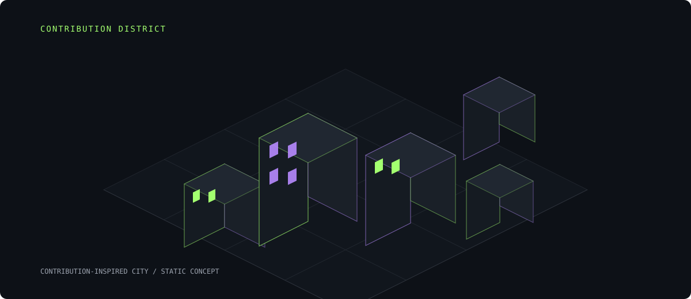

<div align="center">


</div>

---

## `01 / ABOUT`

```text
> identity:  Abhijeet Dhokne
> role:      Computer Science student & Software Developer
> interests: scalable products, system fundamentals, applied AI
> mindset:   understand deeply, build pragmatically, improve continuously
```

I build practical web applications from interface to deployment. My engineering interests span MERN development, Java, databases, Docker, cloud infrastructure, CI/CD, and Applied AI Engineering.

---

## `02 / TECH STACK`

### Programming Languages
<div align="center">

</div>

### Frontend Development
<div align="center">

</div>

### Backend Development
<div align="center">

</div>

### Databases
<div align="center">

</div>

### DevOps &amp; Cloud
<div align="center">

</div>

### Tools &amp; Platforms
<div align="center">

</div>

---

## `03 / GITHUB ANALYTICS`

<div align="center">


<br/>


</div>

---

## `04 / CONTRIBUTION CITY`

<div align="center">

</div>

<sub>Static contribution-inspired concept. This visualization is not connected to live GitHub contribution data.</sub>

---

## `05 / CODING JOURNEY`

LeetCode statistics are not shown until a username is configured. Replace `YOUR_LEETCODE_USERNAME` below with the profile handle to enable the maintained service card.

```markdown

```

---

## `06 / ACHIEVEMENTS`

<div align="center">

</div>

No certifications or verified achievements are listed because no certificates or credentials were supplied.

---

## `07 / CONNECT`

<div align="center">

[](https://abhijeetdhokne.onrender.com/)
[](https://github.com/AbhijeetDhokne)

</div>

LinkedIn and email links are intentionally omitted until verified URLs are available.

---

## `08 / FOOTER`

<div align="center">

> `Build with clarity. Ship with intent.`

<sub>Thanks for visiting.</sub>

</div>

<!--
CONFIGURATION
GitHub username: AbhijeetDhokne
Portfolio URL: https://abhijeetdhokne.onrender.com/
LeetCode username: replace YOUR_LEETCODE_USERNAME in the card above.
LinkedIn URL: add only after verification.
Email: add only after verification.
-->
