<div align="center">


<a href="https://github.com/AbhijeetDhokne">
  
</a>

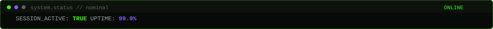

</div>

```bash
$ whoami
Abhijeet Dhokne

$ current_focus
Building scalable applications and engineering reliable systems.

$ mindset
Understand. Build. Break. Optimize. Repeat.
```

> Full Stack Developer working across backend engineering, containerized delivery and cloud infrastructure, currently exploring applied AI with LLMs and RAG.


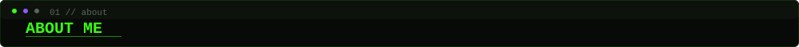

```bash
abhijeet@sys:~$ cat capabilities.conf
```

```diff
+ Full Stack Development
+ Backend Engineering
+ Distributed application architecture fundamentals
+ Containerization and DevOps
+ Cloud infrastructure
+ Continuous Integration and Deployment
+ Exploring LLMs and RAG
```

```bash
abhijeet@sys:~$ ./diagnostics --focus
```

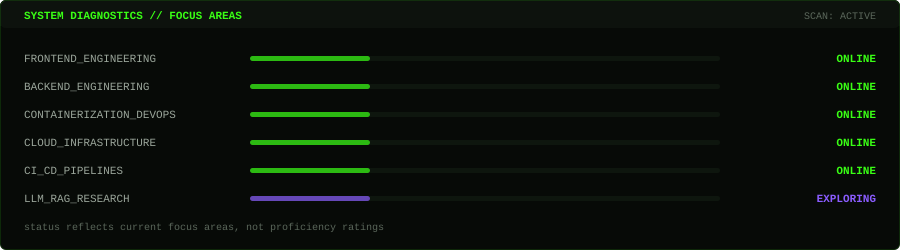


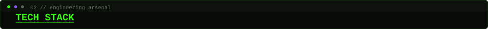

<table>
<tr>
<td width="190"><code>LANGUAGES</code></td>
<td>
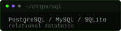
</td>
</tr>
<tr>
<td width="190"><code>FRONTEND</code></td>
<td>

</td>
</tr>
<tr>
<td width="190"><code>BACKEND</code></td>
<td>
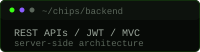
</td>
</tr>
<tr>
<td width="190"><code>DATABASES</code></td>
<td>

</td>
</tr>
<tr>
<td width="190"><code>DEVOPS / INFRA</code></td>
<td>
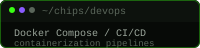
</td>
</tr>
<tr>
<td width="190"><code>DEV TOOLS</code></td>
<td>

</td>
</tr>
<tr>
<td width="190"><code>AI ENGINEERING</code></td>
<td>
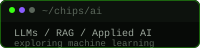
</td>
</tr>
</table>


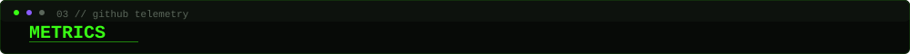

<div align="center">

<table>
<tr>
<td valign="top" align="center">

</td>
<td valign="top" align="center">

</td>
</tr>
<tr>
<td colspan="2" align="center">

</td>
</tr>
<tr>
<td colspan="2" align="center">

</td>
</tr>
<tr>
<td valign="top" align="center">

</td>
<td valign="top" align="center">

</td>
</tr>
</table>


</div>


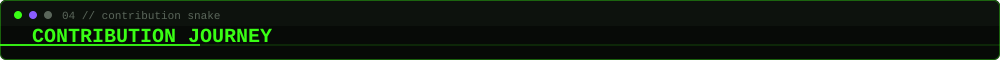

<div align="center">

<picture>
  <source media="(prefers-color-scheme: dark)" srcset="https://raw.githubusercontent.com/AbhijeetDhokne/AbhijeetDhokne/output/github-contribution-grid-snake-dark.svg">
  <source media="(prefers-color-scheme: light)" srcset="https://raw.githubusercontent.com/AbhijeetDhokne/AbhijeetDhokne/output/github-contribution-grid-snake.svg">
  
</picture>

</div>

```bash
abhijeet@sys:~$ snk --user AbhijeetDhokne --schedule daily   # regenerated by GitHub Actions
```


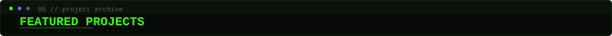

```bash
abhijeet@sys:~$ ls -l ~/projects
total 5
```

<table>
<tr>
<td width="50%" align="center">
<a href="https://github.com/AbhijeetDhokne/canvora"></a>
</td>
<td width="50%" align="center">
<a href="https://github.com/AbhijeetDhokne/Hostmate"></a>
</td>
</tr>
<tr>
<td width="50%" align="center">
<a href="https://github.com/AbhijeetDhokne/weatherapp"></a>
</td>
<td width="50%" align="center">
<a href="https://github.com/AbhijeetDhokne/spotify-clone"></a>
</td>
</tr>
<tr>
<td width="50%" align="center">
<a href="https://github.com/AbhijeetDhokne/catchhive"></a>
</td>
<td width="50%" align="center">
<a href="https://github.com/AbhijeetDhokne?tab=repositories"><code>$ ls --all &gt; view every repository</code></a>
</td>
</tr>
</table>


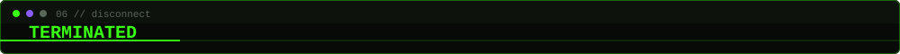

```bash
$ echo "Thanks for visiting my system."
Thanks for visiting my system.

CONNECTION_STATUS : ESTABLISHED
SESSION_STATUS    : ACTIVE
NEXT_MISSION      : BUILD SOMETHING IMPOSSIBLE
```

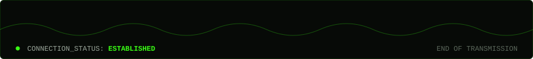

```bash
$ cat contact.conf
```

<table>
<tr>
<td width="190"><code>GITHUB</code></td>
<td><a href="https://github.com/AbhijeetDhokne">github.com/AbhijeetDhokne</a></td>
</tr>
<tr>
<td width="190"><code>EMAIL</code></td>
<td><a href="mailto:abhijeetdhokne1474@gmail.com">abhijeetdhokne1474@gmail.com</a></td>
</tr>
<tr>
<td width="190"><code>LINKEDIN</code></td>
<td><a href="https://www.linkedin.com/in/abhijeetdhokne">linkedin.com/in/abhijeetdhokne</a></td>
</tr>
</table>

<div align="center">
<sub><code>EOF // abhijeet-dhokne // session remains active</code></sub>
</div>