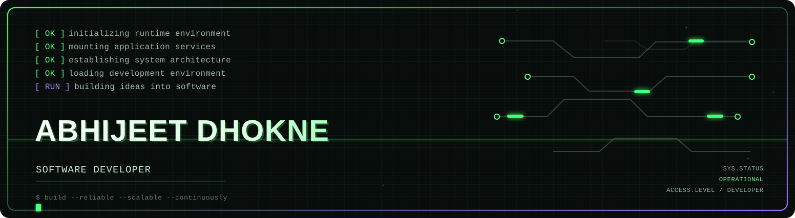
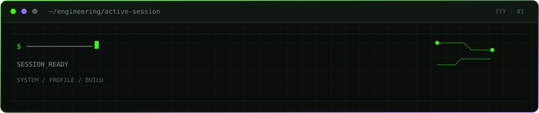
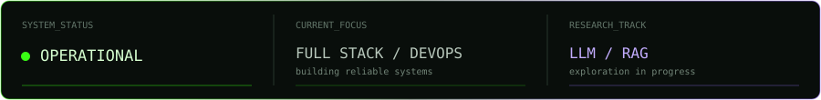

<div align="center">



<a href="https://github.com/AbhijeetDhokne">
  
</a>

</div>

```bash
abhijeet@sys:~$ whoami
Abhijeet Dhokne

abhijeet@sys:~$ printf "%s\n" "$FOCUS"
Building full-stack applications, reliable backend services,
containerized workflows, and exploring applied AI.

abhijeet@sys:~$ cat mindset.txt
Understand. Build. Break. Optimize. Repeat.
```

> Full Stack Developer focused on the MERN ecosystem, backend engineering, containerized development, and CI/CD automation — currently exploring LLMs and Retrieval-Augmented Generation.

<div align="center">
  
</div>

## `01 // system profile`



```text
IDENTITY       Abhijeet Dhokne
PRIMARY STACK  MongoDB · Express · React · Node.js
LANGUAGES      Java · JavaScript · SQL
ENGINEERING    Backend · APIs · Containerization · CI/CD
RESEARCH       LLMs · Retrieval-Augmented Generation
```

I enjoy building practical full-stack applications and understanding how their parts work together — from frontend interfaces and backend APIs to databases, containers, and deployment workflows.

### Current engineering interests

- Building maintainable applications with the MERN stack.
- Designing backend services and REST APIs.
- Working with Docker and Docker Compose.
- Practicing Linux and cloud infrastructure fundamentals.
- Learning CI/CD automation with Jenkins and GitHub Actions.
- Exploring Kubernetes, LLMs, and RAG-based applications.



<sub>Status labels describe current focus areas; they are not proficiency ratings.</sub>

<div align="center">
  
</div>

## `02 // engineering arsenal`

<table>
  <tr>
    <td width="190"><code>LANGUAGES</code></td>
    <td>
      
      <code>SQL</code>
    </td>
  </tr>
  <tr>
    <td><code>FRONTEND</code></td>
    <td>
      
    </td>
  </tr>
  <tr>
    <td><code>BACKEND</code></td>
    <td>
      
      <code>REST APIs</code> <code>JWT</code> <code>MVC</code>
    </td>
  </tr>
  <tr>
    <td><code>DATABASES</code></td>
    <td>
      
    </td>
  </tr>
  <tr>
    <td><code>DEVOPS / INFRA</code></td>
    <td>
      
      <code>Docker Compose</code>
    </td>
  </tr>
  <tr>
    <td><code>CI/CD AUTOMATION</code></td>
    <td>
      
    </td>
  </tr>
  <tr>
    <td><code>DEV TOOLS</code></td>
    <td>
      
    </td>
  </tr>
  <tr>
    <td><code>AI ENGINEERING</code></td>
    <td>
      <code>LLMs</code> <code>RAG</code> <code>Applied AI</code>
    </td>
  </tr>
</table>

<div align="center">
  
</div>

## `03 // ci/cd pipeline`

A look at the automation technologies I work with and continue to explore:

```text
SOURCE
  |
  v
GITHUB REPOSITORY
  |
  +------------------------+
  |                        |
  v                        v
JENKINS              GITHUB ACTIONS
  |                        |
  +-----------+------------+
              |
              v
       BUILD / TEST
              |
              v
     DOCKER IMAGE / ARTIFACT
              |
              v
          DELIVERY
```

<sub>Conceptual workflow illustration — not a claim that every stage is configured in each project.</sub>

<div align="center">
  
</div>

## `04 // github telemetry`

<div align="center">

<a href="https://github.com/AbhijeetDhokne">
  
</a>
<a href="https://github.com/AbhijeetDhokne">
  
</a>

<a href="https://github.com/AbhijeetDhokne">
  
</a>

<a href="https://github.com/AbhijeetDhokne">
  
</a>


</div>

<sub>GitHub statistics are provided by third-party services and may take time to refresh. Private contribution visibility depends on GitHub settings and service support.</sub>

<div align="center">
  
</div>

## `05 // contribution trace`

The contribution snake is generated automatically by GitHub Actions. After the workflow runs successfully, the SVGs are published to the `output` branch.

<div align="center">
  <picture>
    <source media="(prefers-color-scheme: dark)" srcset="https://raw.githubusercontent.com/AbhijeetDhokne/AbhijeetDhokne/output/github-contribution-grid-snake-dark.svg">
    <source media="(prefers-color-scheme: light)" srcset="https://raw.githubusercontent.com/AbhijeetDhokne/AbhijeetDhokne/output/github-contribution-grid-snake.svg">
    
  </picture>
</div>

<div align="center">
  <sub>If the snake is not visible yet, run the <code>Generate contribution snake</code> workflow once from the Actions tab.</sub>
</div>

<div align="center">
  
</div>

## `06 // project archive`

```bash
abhijeet@sys:~$ ls -la ~/projects
canvora/       # real-time collaborative canvas
hostmate/      # rental platform
weatherapp/    # React + Vite weather application
spotify-clone/ # Spotify-inspired interface
catchhive/     # collaborative canvas project
```

| PROJECT | DESCRIPTION | TECHNOLOGY |
|:--|:--|:--|
| **Canvora** | Real-time collaborative canvas platform | `React` `Vite` `Node.js` `Express` `MongoDB` `Docker` |
| **Hostmate** | Full-stack rental platform | `React` `Node.js` `Express` `MongoDB` `Google Maps` `Razorpay` `AWS` `Redis` |
| **WeatherApp** | Weather application | `React` `Vite` |
| **Spotify Clone** | Spotify-inspired music interface project | Stack details not listed |
| **CatchHive** | Collaborative real-time canvas project | Stack details not listed |

<div align="center">

| REPOSITORY | ACCESS |
|:--|:--|
| Canvora | [Open repository](https://github.com/AbhijeetDhokne/canvora) |
| Hostmate | [Open repository](https://github.com/AbhijeetDhokne/Hostmate) |
| WeatherApp | [Open repository](https://github.com/AbhijeetDhokne/weatherapp) |
| Spotify Clone | [Open repository](https://github.com/AbhijeetDhokne/spotify-clone) |
| CatchHive | [Open repository](https://github.com/AbhijeetDhokne/catchhive) |

</div>

<sub>Repository links above follow the paths in the supplied README draft. Confirm each repository exists and adjust capitalization or slug if needed.</sub>

<div align="center">
  
</div>

## `07 // establish connection`

```bash
abhijeet@sys:~$ cat contact.conf
GITHUB   = github.com/AbhijeetDhokne
EMAIL    = abhijeetdhokne1474@gmail.com
LINKEDIN = linkedin.com/in/abhijeetdhokne
```

<div align="center">

<a href="https://github.com/AbhijeetDhokne">GitHub</a>
&nbsp;&nbsp; / &nbsp;&nbsp;
<a href="mailto:abhijeetdhokne1474@gmail.com">Email</a>
&nbsp;&nbsp; / &nbsp;&nbsp;
<a href="https://www.linkedin.com/in/abhijeetdhokne">LinkedIn</a>



<sub><code>EOF // ABHIJEET DHOKNE // SESSION REMAINS ACTIVE</code></sub>

</div>
